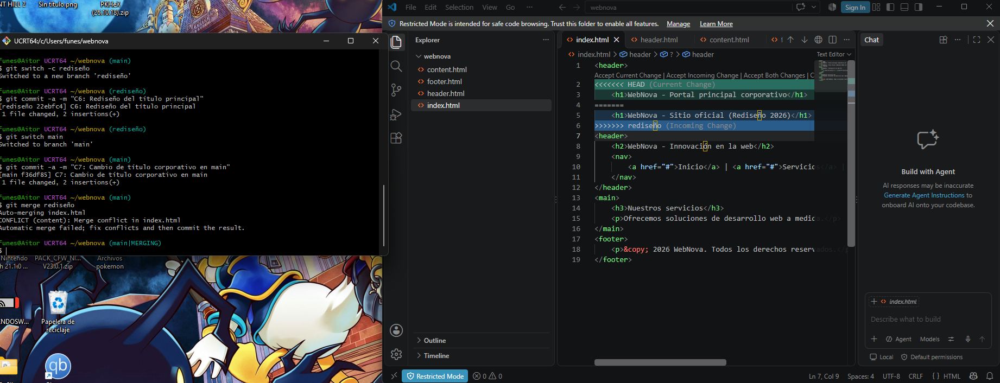
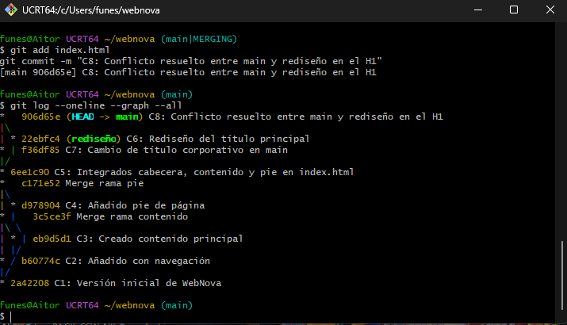

# Práctica 4. Gestión Avanzada de Ramas y Resolución de Conflictos

## 1. Evidencias Prácticas

### Resolución del conflicto
A continuación se muestra el estado del archivo `index.html` con las marcas de conflicto generadas por Git en la terminal y en el editor, antes de la resolución manual:

### Historial de ramas (Git Log)
Gráfico resultante tras realizar las fusiones limpias, provocar la divergencia y resolver el conflicto a tres bandas:

---

## 2. Reflexión Teórica

### ¿Por qué ocurrió el conflicto en la PARTE 3 y por qué no ocurrió en la PARTE 2?
En la parte 2 no hubo conflictos porque las modificaciones se hicieron añadiendo archivos nuevos e independientes (cabecera, contenido, pie) que no colisionaban entre sí. En la PARTE 3, el conflicto ocurrió porque modificamos **exactamente la misma línea del mismo archivo** (`index.html`) en dos ramas distintas (`main` y `rediseño`) de manera paralela. Al intentar fusionarlas, Git no puede inferir automáticamente qué versión debe prevalecer, por lo que pausa la fusión y requiere intervención manual para unificar el código.

### Al ejecutar `git switch main` en la PARTE 3.2, ¿qué ocurrió con los archivos de tu directorio de trabajo?
Al cambiar de rama, Git mueve el puntero `HEAD` hacia la rama principal. Al hacerlo, actualiza automáticamente el directorio de trabajo (Working Directory) en el sistema operativo. Los archivos en el editor cambiaron instantáneamente para reflejar el estado exacto en el que se encontraba la rama `main` en ese momento, ocultando temporalmente los cambios que se acababan de confirmar en la rama `rediseño`.